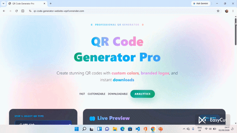
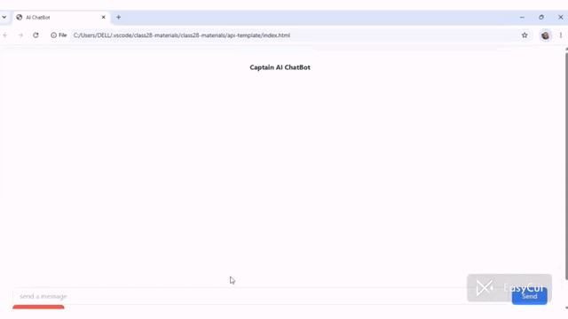
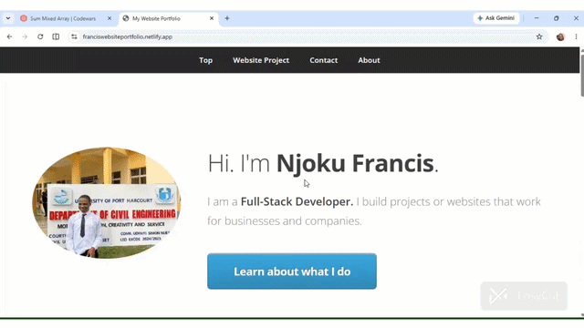
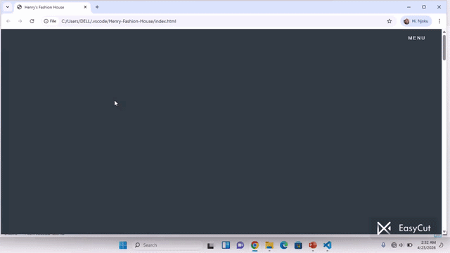
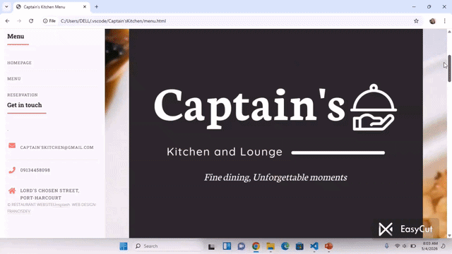

<h1 align="center">Hi 👋, I'm Njoku Francis</h1>
<h3 align="center">A passionate Full-stack Developer</h3>

  

  

  

<h2 align="center">My Projects</h2>

- 📱 My Project 

- 🔭 My Project 

- 🌱 My Project 

- 👯 My Project 

- 🤝 My Project 

- 🥗 My Project 

- 💬 Ask me about **HTML, CSS, Javascript, React, Node, OOP, MongoDB, Express**

- 📫 How to reach me **frannjoku200@gmail.com**

<h3 align="left">Connect with me:</h3>

<a href="https://x.com/Francisdev10" target="blank">

<h3 align="left">Languages and Tools:</h3>

 <a href="https://www.w3schools.com/css/" target="_blank" rel="noreferrer"> 

&nbsp;

